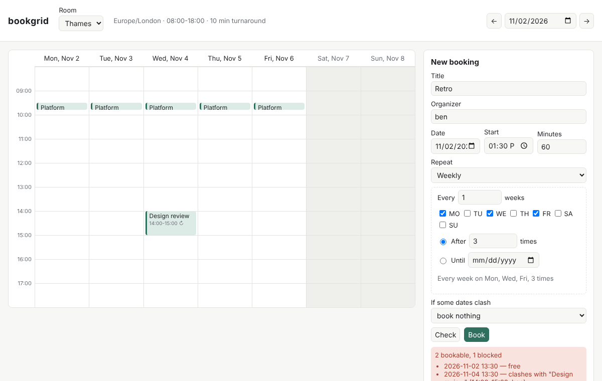

# bookgrid: room booking that survives timezones, DST and double-clicks

A small full-stack booking system for shared rooms: a **FastAPI + SQLite**
backend and a **TypeScript** week-view UI. It covers the parts of booking
that a CRUD tutorial skips:

* **Recurring series in the room's local time.** "Mondays 09:00 in London"
  stays 09:00 London across the clock change; the UTC instant moves.
* **DST edge cases with defined behaviour.** A time that doesn't exist
  (02:30 on spring-forward day) is shifted forward like RFC 5545 says. A time
  that happens twice (01:30 on fall-back day) uses the first one. Either way
  the occurrence carries a note so the UI can show it.
* **No double booking under concurrency.** The conflict check and the insert
  happen in one `BEGIN IMMEDIATE` transaction. A measured race benchmark
  compares this with a check-then-insert baseline.
* **Turnaround buffers, opening hours and closed days**, checked for every
  occurrence of a series.
* **All-or-nothing or skip.** A series with clashing dates is either
  rejected whole (`reject`, the default) or booked minus the clashing dates
  (`skip`). Both return a per-date explanation naming the booking it clashes with.
* **Idempotent creates** via an `Idempotency-Key` header. The UI keeps one
  key per unchanged form, so a double-click or a retry after a timeout cannot
  book twice.
* **Exceptions to a series**: move one occurrence, or cancel *this*,
  *this and following*, or the *whole series*.
* **Free-slot search** that uses the same conflict rule as booking. A test
  checks that every slot it offers can be booked and every slot it leaves out
  can't.



## Architecture

```
frontend/ (TypeScript, no framework)        bookgrid/ (Python)
  src/rrule.ts  form <-> RRULE text           api.py         FastAPI routes, pydantic models, static UI
  src/grid.ts   week maths, block layout      store.py       SQLite schema, planning, conflict check,
  src/api.ts    typed client, error lines                    transactions, idempotency, move/cancel, free slots
  src/app.ts    DOM wiring                    recurrence.py  RRULE subset, date expansion, DST-aware localize()
        |  JSON over /api                     seed.py        load samples/seed.json
        +-----------------------------------> race.py        naive vs transactional concurrency benchmark
```

Data model (SQLite):

| table | purpose |
|---|---|
| `resources` | room name, IANA timezone, opening hours, open weekdays, turnaround buffer |
| `series` | what the user asked for: title, organizer, local start date/time, duration, normalised RRULE |
| `occurrences` | one row per materialised occurrence: `recurrence_date` (the series key), UTC `start_ts`/`end_ts`, `status`, `moved`, DST `note`. `UNIQUE(series_id, recurrence_date)` |
| `idempotency` | key → request hash + stored 201 response |

Booking flow (`Store.book`):

1. `BEGIN IMMEDIATE`: take SQLite's write lock before reading anything.
2. If an `Idempotency-Key` is present and known, replay the stored response,
   or return 422 if the body differs.
3. Expand the rule to local dates, then `localize(date, wall_time, tz)` each one to UTC.
4. For each occurrence, check opening hours and closed days in local time,
   look for overlaps with the buffer applied
   (`a.start < b.end + buf AND b.start < a.end + buf`) using the
   `(resource_id, status, start_ts)` index, and check it doesn't overlap the
   series' previous occurrence.
5. Reject (409, nothing written) or insert the bookable rows. The response
   is stored under the idempotency key in the same transaction.

## Setup

```bash
cd projects/2026-10-30-bookgrid
python -m venv .venv && . .venv/bin/activate
pip install -r requirements.txt
(cd frontend && npm install && npm run build)   # builds frontend/dist
python -m bookgrid seed --db bookgrid.db        # 3 rooms (London, New York, Kolkata), 52 occurrences
python -m bookgrid serve --db bookgrid.db       # http://127.0.0.1:8000/?week=2026-11-02
```

Python 3.11+ (uses `zoneinfo`), Node 18+ for the UI build. No paid services.
On systems without IANA tz data (some Windows installs), `pip install tzdata`.

## Usage

UI: pick a room and a week. Click an empty spot to prefill the date and time.
**Check** previews every occurrence with its problems. **Book** creates the
booking. Click a booking to move it or cancel it.

API (OpenAPI docs at `/docs`):

```bash
curl -s localhost:8000/api/bookings -H 'Content-Type: application/json' \
  -H 'Idempotency-Key: 6b1e7c1c-retro' -d '{
    "resource_id": 1, "title": "Retro", "organizer": "ben",
    "date": "2026-11-02", "start_time": "13:30", "duration_minutes": 60,
    "rrule": "FREQ=WEEKLY;BYDAY=MO,WE,FR;COUNT=3", "on_conflict": "skip"}'
```

| method & path | what it does |
|---|---|
| `GET/POST /api/resources` | list / create rooms |
| `GET /api/resources/{id}/occurrences?start=&end=` | active occurrences between two local dates (≤ 62 days) |
| `GET /api/resources/{id}/free?date=&duration=&step=` | bookable start times on a local date |
| `POST /api/bookings/preview` | dry run: each occurrence with `problems` |
| `POST /api/bookings` | create (201), 409 with per-date `details`, 422 on bad input |
| `GET /api/series/{id}` | series with every occurrence, including cancelled ones |
| `PATCH /api/occurrences/{id}` | move one occurrence (`date`, `start_time`, optional `duration_minutes`) |
| `POST /api/occurrences/{id}/cancel` | `{"scope": "this" \| "following" \| "series"}` |

Supported recurrence: `FREQ=DAILY|WEEKLY`, `INTERVAL`, `BYDAY` (weekly only),
and exactly one of `COUNT` or `UNTIL` (an inclusive local date). Series are
capped at 366 occurrences.

## Sample inputs and expected outputs

`samples/requests/*.json` are replayed in order on top of `samples/seed.json`.
The responses are stored in `samples/expected/`. `python samples/run_samples.py`
diffs the live responses against them (exit 1 on any mismatch), and
`tests/test_api.py` runs that check.

| sample | outcome |
|---|---|
| `01_weekly_across_dst` | 201. New York 16:30 on Mon/Thu: `20:30Z` before 1 Nov 2026, `21:30Z` after |
| `02_conflict_reject` | 409. Daily 13:30-14:30 clashes with *Design review* (14:00) on 4 Nov, so nothing is written |
| `03_conflict_skip` | 201. Same slot, Mon/Wed/Fri with `skip`: books 2 and 6 Nov, explains why 4 Nov was skipped |
| `04_spring_forward_gap` | 201. 02:30 daily in New York: 13 Mar at 02:30 EST, 14 Mar shifted to 03:30 EDT with a note |
| `05_free_slots_thames` | free 60-min starts on 4 Nov, with the 10-minute buffer around standup and review |

## Tests

```bash
python -m pytest -q                         # 43 tests: recurrence, store, API, samples, browser e2e
(cd frontend && npm test)                   # 14 tests: rrule builder, grid maths, API client
```

`tests/test_ui_e2e.py` drives the built UI in headless Chromium. It loads the
seeded week, fills the form, gets the conflict message, rebooks with `skip`,
then cancels the series. It is skipped if the UI isn't built or Playwright
isn't installed. If Playwright's own browser is missing, set
`BOOKGRID_CHROMIUM=/path/to/chrome`.

Measured results from the latest run: **43 passed** (pytest, e2e included)
and **14 passed** (node:test).

### Race benchmark (measured)

`python -m bookgrid race` starts N threads behind a barrier, all booking the
same 60-minute slot on a fresh database, and counts how many succeed:

| run | mode | trials with >1 booking | max bookings in one slot | mean per slot |
|---|---|---|---|---|
| 20 trials × 8 clients, 20 ms pause | naive check-then-insert | 20 / 20 | 8 | 8.0 |
| | transactional (`BEGIN IMMEDIATE`) | 0 / 20 | 1 | 1.0 |
| 20 trials × 8 clients, no pause | naive check-then-insert | 20 / 20 | 8 | 6.95 |
| | transactional (`BEGIN IMMEDIATE`) | 0 / 20 | 1 | 1.0 |

The pause stands in for a slow network hop between check and write. Even
without it, the naive version double-booked in every trial on this machine.
Exact counts vary between runs and machines; the transactional result does not.

## Design decisions

* **Materialise occurrences.** Each occurrence is a row, so conflict checks
  are a single indexed range query and per-occurrence exceptions (moved,
  cancelled) need no special cases. The cost is that series must be bounded.
* **Store the local rule, check in UTC.** The series keeps the wall time
  and the room's timezone. Occurrences store UTC epoch seconds, so overlap
  is integer comparison, and a 60-minute meeting on fall-back night is 60
  real minutes.
* **`fold=0` implements RFC 5545 for both DST cases** (PEP 495): pre-gap
  offset for nonexistent times, first instant for ambiguous ones. A
  round-trip check tells the two cases apart and produces the note.
* **The buffer belongs to the room**, so it applies in both directions
  between any two bookings. Half-open intervals mean back-to-back bookings
  are allowed when the buffer is 0.
* **`BEGIN IMMEDIATE` instead of optimistic retries.** SQLite has a single
  writer anyway. Taking the lock before reading makes check-then-write
  atomic, with no retry loop and no unique-constraint tricks.
* **Failed requests are not cached under the idempotency key.** A 409 today
  should be retryable tomorrow, after the clashing booking is cancelled
  (tested).
* **Dates in the UI are the room's dates.** The UI positions blocks from the
  API's local ISO strings and does calendar maths in UTC, so a browser in
  Tokyo still shows a London room on London's grid.

## Limitations

* Only DAILY/WEEKLY rules. No MONTHLY/YEARLY, `BYSETPOS`, `EXDATE`, or
  unbounded series. Editing a whole series' time means cancelling the
  following occurrences and booking a new series.
* `DTSTART` counts only if it matches the rule (python-dateutil semantics;
  strict RFC 5545 always includes it).
* SQLite serialises writers, which is fine for one office's rooms. A
  multi-node deployment would need Postgres with an exclusion constraint
  (`tstzrange &&`) or equivalent.
* Open hours must lie within one local day; overnight rooms aren't modelled.
  A day with a DST gap in opening hours has fewer slots, which is correct
  but not explained in the UI.
* No authentication or authorisation. Anyone can cancel anything, and
  `organizer` is free text.
* Idempotency keys never expire.
* The UI has no fall-back-night handling: the two 01:30s are drawn in the
  same spot.
